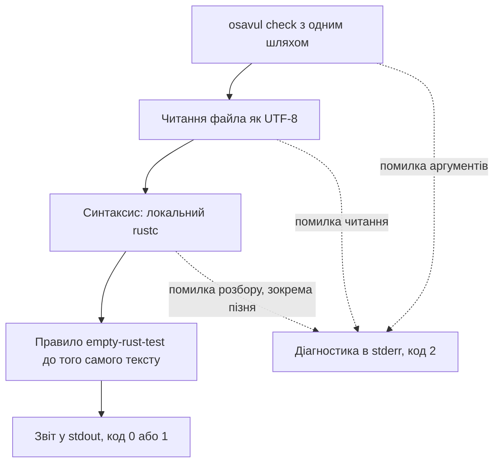
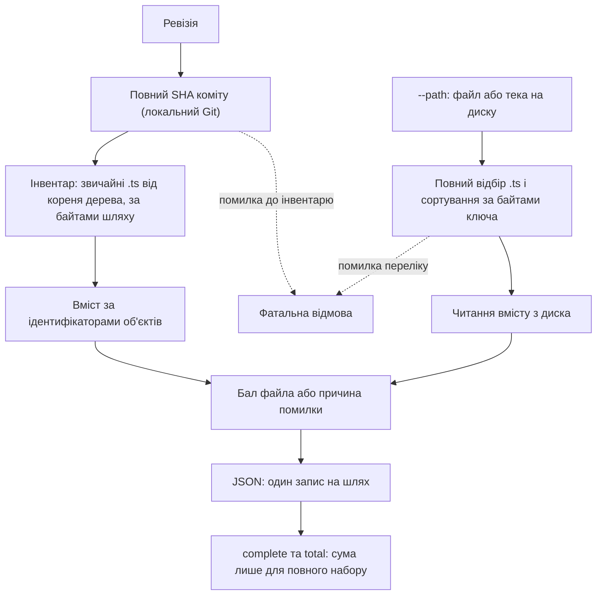

# Огляд потоку даних

Аналіз читає текст одного файла: код не виконується, макроси не розгортаються, зовнішні модулі не підвантажуються. Синтаксис перевіряє локальний `rustc`, і лише після успішного розбору правило застосовується до того самого тексту; тому помилка розбору, навіть після потенційної знахідки, не лишає часткового звіту. Значення результату пояснює [Знахідка](../domain/entities/finding.md), а причину такого підходу — [ADR-0001](decisions/0001-deterministic-static-analysis.md).

## Синтаксичний підрахунок TypeScript

Бал одного файла `.ts` обчислює вбудований парсер Oxc: текст має бути UTF-8, синтаксична діагностика (навіть коли парсер відновив дерево) дає помилку файла, а не часткове число. Режим `.d.ts` обирається за суфіксом шляху. Код не виконується, імпорти не завантажуються, типи не перевіряються. Причину вибору парсера пояснює [ADR-0002](decisions/0002-typescript-parser-dependency.md).

## Звіт складності

Джерело вмісту — коміт або локальний шлях; далі обидва проходять той самий підрахунок і побудову JSON.

Шляхи, вміст і SHA походять лише з об'єктів одного коміту, тому індекс і робоче дерево не впливають на вимір. Помилка читання одного об'єкта не зупиняє решту файлів: звіт стає неповним, а сума — `null`. Локальне джерело (`osavul complexity --path <файл-або-тека>`) читає поточний диск без Git: спершу складає повний впорядкований перелік, і лише потім читає вміст; помилка переліку завершує команду до виведення JSON, а помилка читання вже відібраного файла робить звіт неповним. Виклик для коміту — `osavul complexity <ревізія>`: код 0 — повний звіт, 1 — неповний, 2 — фатальна відмова (порожній stdout). Бал файла обчислюють три модулі (цикломатичний і когнітивний обходять дерево, `ts-loc` читає токени коду того самого розбору Oxc, зібрані лише для нього) на спільній підготовці й перевірці діагностик; один з них обирає опція `--metric <cyclomatic|cognitive|loc>` (типово `cyclomatic`) для обох джерел. Інваріанти й методику описує [Звіт складності](../domain/entities/complexity-report.md).
