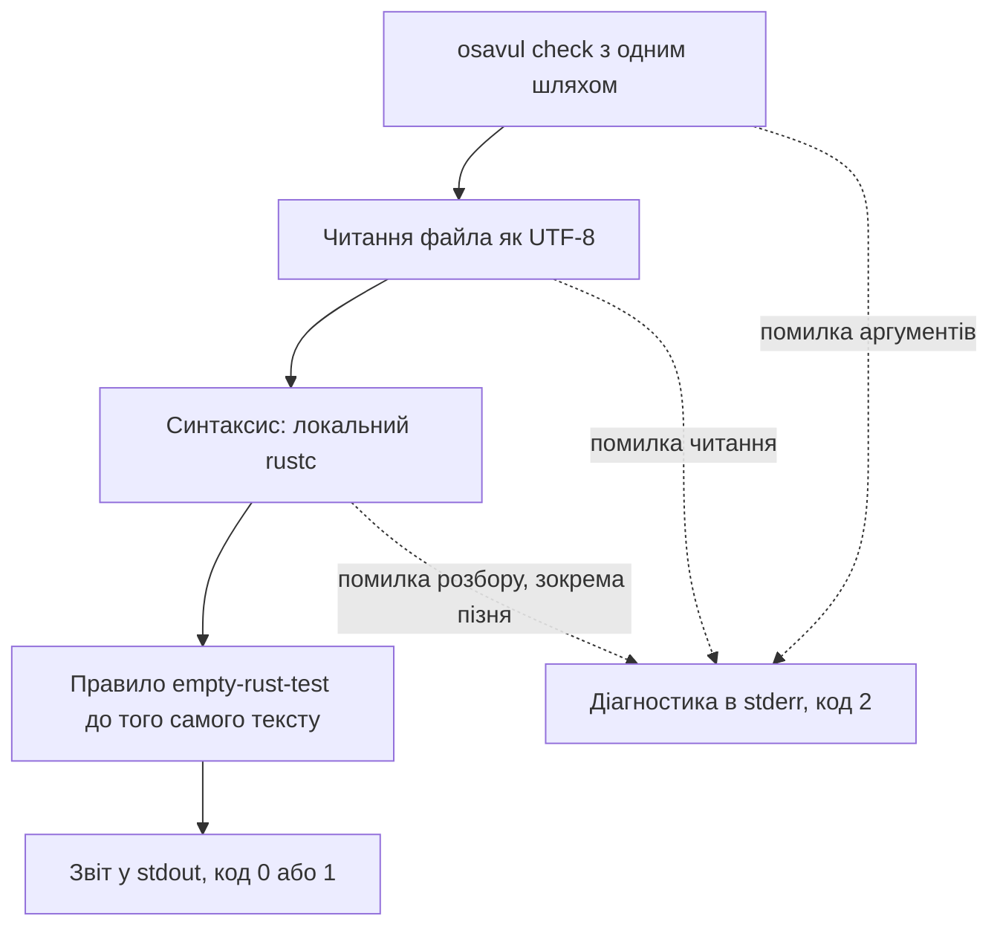

# Огляд потоку даних

Аналіз читає текст одного файла: код не виконується, макроси не розгортаються, зовнішні модулі не підвантажуються. Синтаксис перевіряє локальний `rustc`, і лише після успішного розбору правило застосовується до того самого тексту; тому помилка розбору, навіть після потенційної знахідки, не лишає часткового звіту. Значення результату пояснює [Знахідка](../domain/entities/finding.md), а причину такого підходу — [ADR-0001](decisions/0001-deterministic-static-analysis.md).
