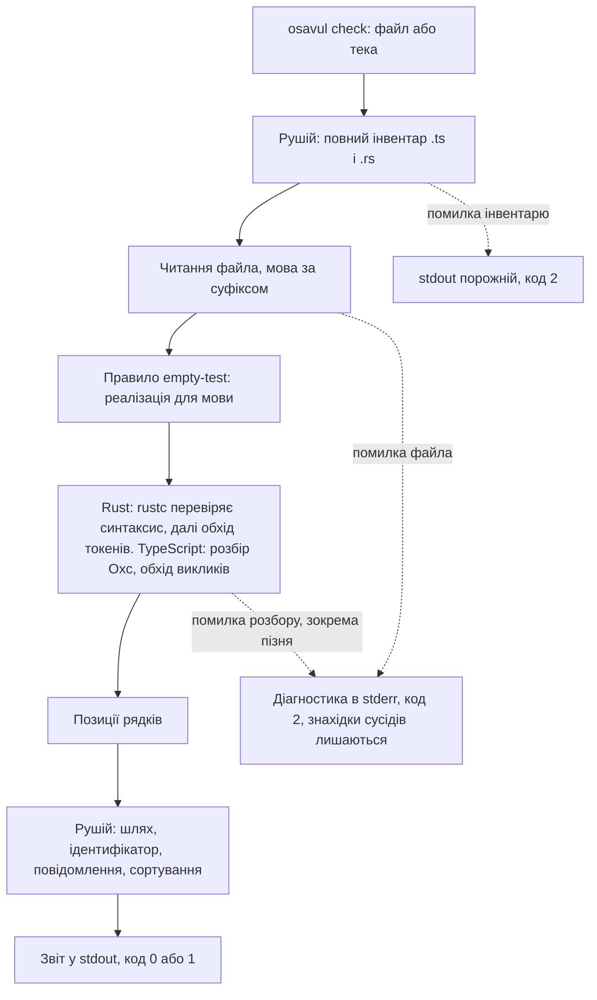
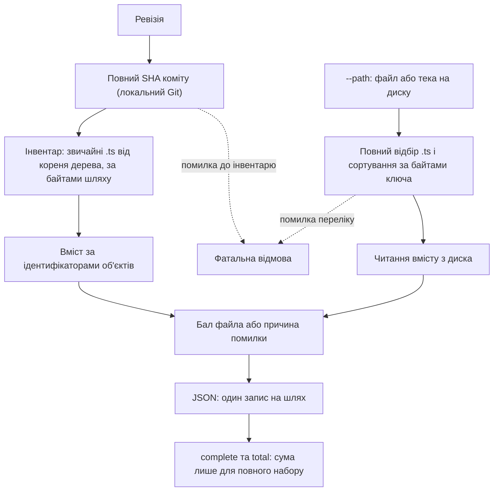

# Огляд потоку даних

`osavul check` ділиться на рушій і правила. Рушій складає інвентар до читання джерел, визначає мову за суфіксом, запускає застосовні правила, доповнює позиції шляхом, ідентифікатором і повідомленням, сортує знахідки, друкує їх і визначає код завершення. Правило має один ідентифікатор і зміст для всіх мов та окрему реалізацію для кожної; вона бачить лише вміст одного файла й повертає фізичні рядки або причину відмови. Перелік правил статичний. Рішення пояснює [ADR-0004](decisions/0004-check-engine-and-rules.md).

Аналіз читає текст файла: код не виконується, макроси не розгортаються, зовнішні модулі не підвантажуються. Синтаксис Rust перевіряє локальний `rustc`, а TypeScript розбирає Oxc (будь-яка синтаксична діагностика відхиляє весь файл); лише після успішного розбору правило застосовується до того самого тексту. `rustc` потрібен лише для відібраних `.rs`. Помилка файла відкидає всі його знахідки, але не перевірку решти файлів. Значення результату пояснює [Знахідка](../domain/entities/finding.md), а причину детермінованого підходу — [ADR-0001](decisions/0001-deterministic-static-analysis.md).

## Синтаксичний підрахунок TypeScript

Бал одного файла `.ts` обчислює вбудований парсер Oxc: текст має бути UTF-8, синтаксична діагностика (навіть коли парсер відновив дерево) дає помилку файла, а не часткове число. Режим `.d.ts` обирається за суфіксом шляху. Код не виконується, імпорти не завантажуються, типи не перевіряються. Причину вибору парсера пояснює [ADR-0002](decisions/0002-typescript-parser-dependency.md).

## Звіт складності

Джерело вмісту — коміт або локальний шлях; далі обидва проходять той самий підрахунок і побудову JSON.

Шляхи, вміст і SHA походять лише з об'єктів одного коміту, тому індекс і робоче дерево не впливають на вимір. Помилка читання одного об'єкта не зупиняє решту файлів: звіт стає неповним, а сума — `null`. Локальне джерело (`osavul complexity --path <файл-або-тека>`) читає поточний диск без Git: спершу складає повний впорядкований перелік, і лише потім читає вміст; помилка переліку завершує команду до виведення JSON, а помилка читання вже відібраного файла робить звіт неповним. Виклик для коміту — `osavul complexity <ревізія>`: код 0 — повний звіт, 1 — неповний, 2 — фатальна відмова (порожній stdout). Бал файла обчислюють три модулі (цикломатичний і когнітивний обходять дерево, `ts-loc` читає токени коду того самого розбору Oxc, зібрані лише для нього) на спільній підготовці й перевірці діагностик; один з них обирає опція `--metric <cyclomatic|cognitive|loc>` (типово `cyclomatic`) для обох джерел. Інваріанти й методику описує [Звіт складності](../domain/entities/complexity-report.md).

## Потік звіту дублювання

`osavul duplication <ревізія>` і `osavul duplication --path <файл-або-тека>` беруть той самий впорядкований інвентар, що й `complexity`, готують для кожного успішно розібраного файла рядки токенів, а потім виконують один спільний пошук повторів між усіма цими файлами. Проблемні файли зберігаються при шляхах з причиною помилки й у пошуку не беруть участі; тоді звіт неповний (код 1, `total` — `null`). Дублі на код завершення не впливають. Методику, покриття й межі часткового результату описує [Звіт дублювання](../domain/entities/duplication-report.md).

## Потік звіту покриття

`osavul coverage <ревізія> --lcov <файл>…` і `osavul coverage --path <тека> --lcov <файл>…` мають два входи: код і готові звіти LCOV. Код дає той самий впорядкований інвентар, що й `complexity`; для ревізії корінь зіставлення — верхня тека робочого дерева (у bare-репозиторії — тека самого репозиторію), для `--path` — вказана тека. LCOV читаються з диска, а Осавул тести не запускає. Кожен блок `SF` лексично зіставляється з ключами інвентарю, тести (`--tests`) виключаються, блоки одного файла зливаються, а кожен основний файл перевіряється спільним парсером TypeScript: звідти беруться межі рядків для перевірки LCOV і знаменник для файла без запису в звітах. Результат — пофайлові метрики й агрегат; будь-яка невідповідність дає неповний звіт (код 1). Правила й межі описує [Звіт покриття](../domain/entities/coverage-report.md).

Усі три цільові платформи (Ubuntu Linux, Windows, macOS на Apple Silicon) і межі гарантій для імен файлів описує [ADR-0003](decisions/0003-target-platforms.md).

## Потік quality gate

`osavul gate <база> <ревізія>` отримує два повні дерева з комітів: ревізії розв'язуються до SHA, перелік і вміст беруться з об'єктів Git, тож індекс і диск не впливають. Для кожного боку відбір за політиками умов застосовується до кореневих ключів, далі вміст проходить спільний рушій правил `check` і спільний підрахунок дублювання; власних аналізів gate не має. Gate порівнює суми кожної умови, а за зростання пояснює його місцями за тими самими ключами. Будь-яка помилка файла чи джерела робить вердикт неможливим: stderr містить причини, stdout порожній, код `2`. Вердикт друкується лише після того, як усе обчислено. Сутність описує [Quality gate](../domain/entities/quality-gate.md), причину порівняння сум — [ADR-0005](decisions/0005-quality-gate-ratchet.md).
